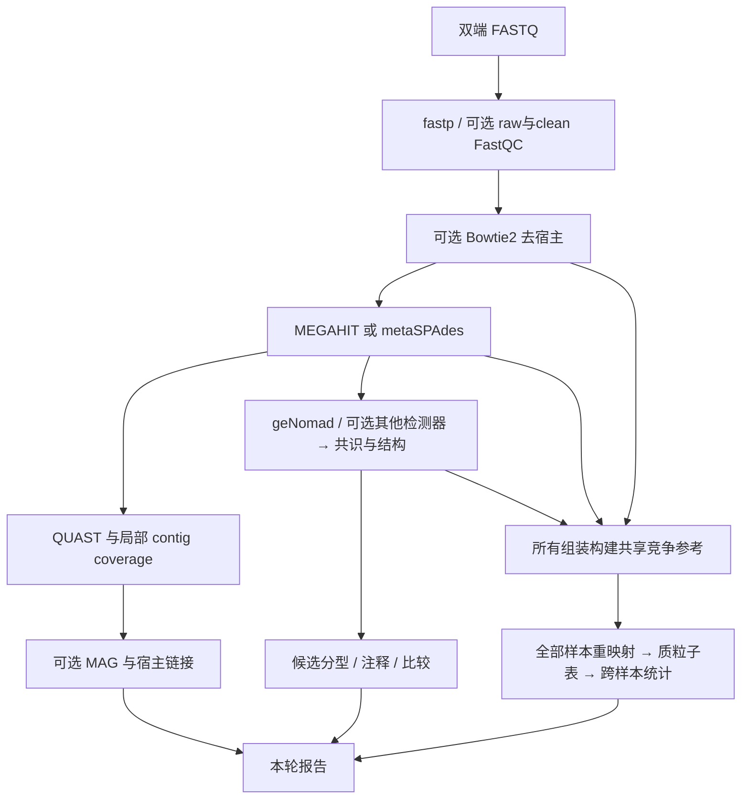
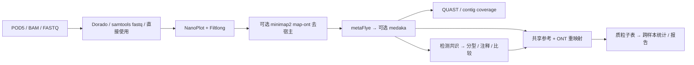
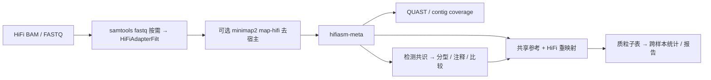
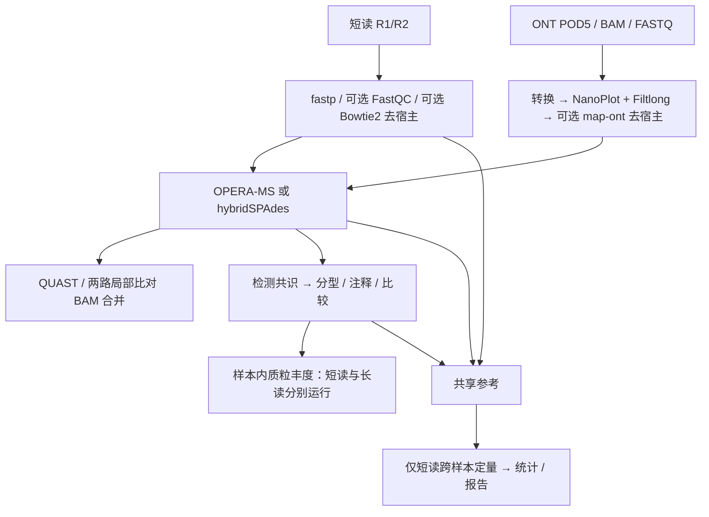
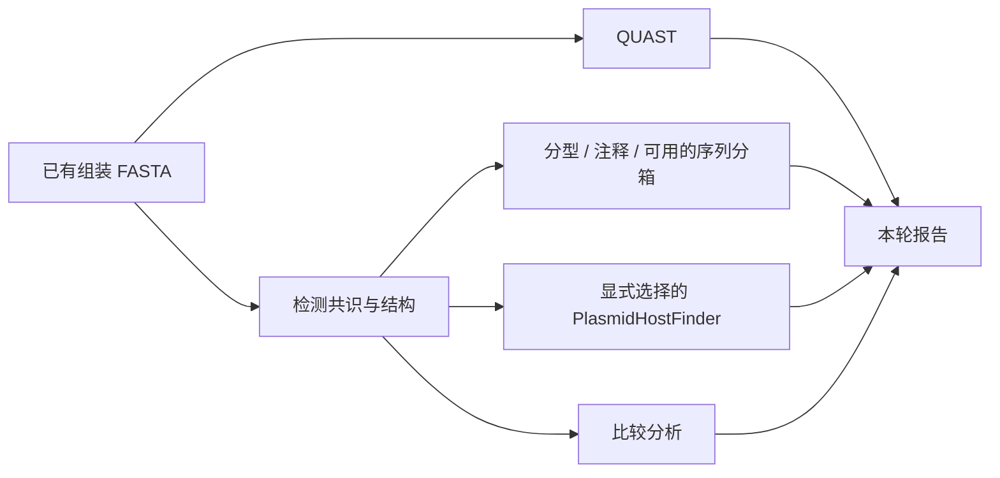
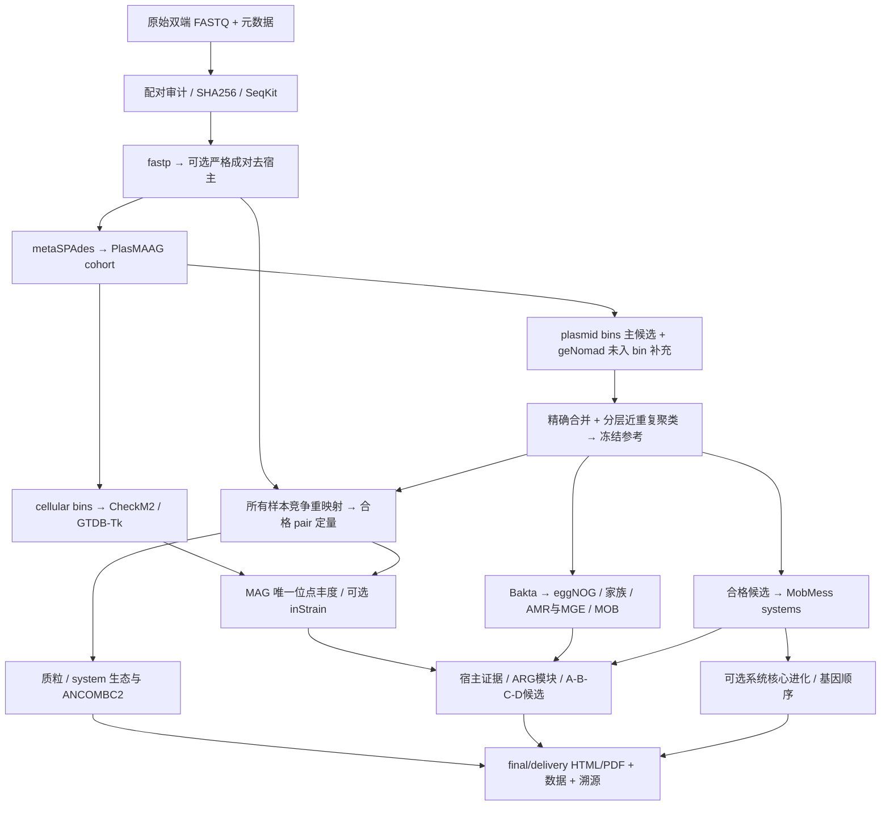

# 各平台流程路线

核对日期：2026-10-31。入口为 [main.nf](../main.nf)，默认参数为 [nextflow.config](../nextflow.config)。下列箭头表示数据依赖；分型、注释、宿主与比较等分支可并行，阶段编号不等于严格串行顺序。

## 路由总表

| 入口 | QC / 去宿主 | 组装 | 共享定量 reads | 特有边界 |
| --- | --- | --- | --- | --- |
| Illumina 通用 | fastp；可选 Bowtie2 | MEGAHIT 默认 / metaSPAdes | 双端短读 | 与 protocol 的参考和计数契约不同 |
| ONT | NanoPlot + Filtlong；可选 minimap2 map-ont | metaFlye；可选 medaka | ONT | POD5 可先 Dorado，BAM 先转 FASTQ |
| PacBio HiFi | HiFiAdapterFilt；可选 minimap2 map-hifi | hifiasm-meta | HiFi | 没有 medaka / NanoPlot / MultiQC 接线 |
| Hybrid | 短读 fastp；ONT NanoPlot + Filtlong；分别去宿主 | OPERA-MS 默认 / hybridSPAdes | 只用短读 | 局部覆盖可合并 BAM，跨样本不合并计数 |
| Assembly | 无 reads QC/去宿主 | 已有 FASTA | 无 | 无 reads 定量、MAG、宿主链接和丰度统计 |
| Illumina + protocol profile | 原始配对审计 + fastp；严格双端去宿主 | metaSPAdes → PlasMAAG cohort | 合格 paired fragments | 冻结目录、质粒/系统两级分析和最终交付 |

## Illumina 通用路线

源码：[illumina.nf](../subworkflows/illumina.nf)。必需 `read1`/`read2`。

MultiQC 默认汇总 fastp，启用 FastQC 时一并收集。可选 gplas2 在同次 metaSPAdes 图节点上重新检测并分箱；Recycler 需要同次 SPAdes FASTG 与短读。PlasMAAG 是组装/reads cohort 分支，通用模式中的 bin 输出不能冒充 protocol 的统一主候选目录。默认 MAG 和宿主链接均关闭；MetaPhlAn 在 clean/去宿主后的短读上做群落谱。

## ONT 路线

源码：[ont.nf](../subworkflows/ont.nf)。输入按 `pod5 → bam → long_reads` 取首个非空值。

samtools fastq 的未配对长读从 `other` 桶取出。去宿主保留未比对的单端长读，全部被过滤则失败。局部 long BAM 可为显式启用的 long-read 宿主链接提供输入，仍需 MAG/候选及相应证据；不能仅凭存在长读就认定物理宿主。MetaPhlAn 使用长读；MultiQC 汇总各样本 NanoPlot HTML/TXT。medaka 只在 `polishing_tools` 选择它时运行，并记录实际模型身份。

## PacBio HiFi 路线

源码：[pacbio_hifi.nf](../subworkflows/pacbio_hifi.nf)。BAM 优先，否则使用 `long_reads`。

HiFiAdapterFilt 使用包内 adapter 数据库。局部覆盖与共享定量均采用 map-hifi；MetaPhlAn 使用过滤后的 HiFi。可选 MAG/long-read linking 复用通用子流程。本入口未调用 MultiQC，`run_multiqc` 不会为 HiFi 自动增加汇总任务；也不应套用 ONT 的 Filtlong/medaka 路线。

## Hybrid 路线

源码：[hybrid.nf](../subworkflows/hybrid.nf)。每行必须同时有双端短读和 ONT 长读输入；当前长读链按 ONT/map-ont 处理。

MetaPhlAn 使用短读。短读与 ONT 各有 MultiQC 汇总；过滤后长读为空时失败，不退回短读单独组装。gplas2/Recycler 依赖 hybridSPAdes 原图；默认 OPERA-MS 路线不能用缺失的 SPAdes 图替代。可选 MAG 使用局部合并覆盖，长读宿主链接使用独立 long BAM。这些用途不改变跨样本仅短读的计量口径。

## Assembly 路线

源码：[assembly.nf](../subworkflows/assembly.nf)。输入为 `assembly` FASTA。

输入以 `assembly_provided` 记录。默认的 MetaPhlAn 在本平台不运行，PlasmidHostFinder 需要显式选择及其数据库。没有 QC、reads coverage、共享丰度、MAG、host linking、多样性、差异与网络；缺失这些结果是入口能力边界，不能补零生成丰度或阴性宿主结论。

## Illumina 短读长 protocol 路线

源码：[profile](../conf/short_read_protocol.config)、[短读长子流程](../subworkflows/short_read_protocol.nf)、[目录子流程](../subworkflows/protocol_catalogue.nf)。启用后替换通用 Illumina 下游；资源与科学门槛详见 [PROTOCOL](../PROTOCOL.md)。

Profile 默认开启 MOSTPLAS/PLSDB、进化、strain，并关闭旧 Welch 探索差异分支。MOSTPLAS/MobMess 需要近完整资格，树需要足够核心及成员，inStrain 需要足够 MAG 唯一位点及覆盖，MAG–质粒 FastSpar 需要每层至少20个独立非空样本；没有资格会记录状态。质粒与 system 的生态/ANCOMBC2 在最终包之前执行，通用 CROSS_SAMPLE 不重复这两项。跨样本网络 `run_network` 是另一个默认关闭的探索分支，不能与带 bootstrap 的 MAG–质粒关联混称。

## 通用下游与计量边界

通用 reads 路线均通过 [SHARED_QUANTIFICATION](../subworkflows/shared_quantification.nf) 建立全组装的精确/反向互补去重竞争参考，再抽取有质粒来源的子表；保留无候选样本。可选 MMseqs2 比较目录独立，不反馈定量。CoverM `raw_count` 为 read 比对数，paired mates 分开。Protocol 对候选做分层近重复合并，背景只精确合并；每个合格 proper pair 计一个 fragment，深度对重叠 mates 去重。

通用 [CROSS_SAMPLE](../subworkflows/cross_sample.nf) 先验证完整矩阵，再将**质粒表**传给多样性、内部探索差异、可选 ANCOMBC2/DESeq2 和网络。默认多样性至少3样本；内部差异需至少两组并满足脚本资格；网络默认关闭、至少20样本且过滤后仍合格。通用 beta 默认 `none`，protocol 为 `tss`，均由模块传入。完整样本数不能替代非空、独立、设计可估计的有效样本数。

通用默认分型为 PlasmidFinder/MOB-typer，注释为 Bakta/AMRFinderPlus/ISEScan/IntegronFinder，比较为 MMseqs2；额外工具需要显式选择和资源。MAG 默认关闭；多 binner 需显式 DAS Tool，PlasMAAG cellular bins 仅在 protocol 中作为唯一 MAG 来源。宿主链接默认关闭；CRISPR 尚未实现，HOTSPOT 需额外源码/数据库/模型。默认 geNomad 单工具、共识分数、环化预测及关联边均不能当作独立实验确证。
